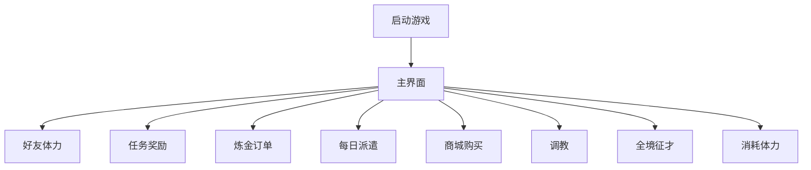

# 功能流程总览

当前客户端提供以下九项任务。点击功能说明查看起始页面、选项、资源消耗和结束条件；流程图描述实现，不代表所有分支均已实测。

总览表示各功能的主要入口关系，不表示任务执行顺序；各任务的返回与异常分支见对应详情图。

| 功能     | 入口节点                  | 风险 | 文档                                |
| -------- | ------------------------- | ---- | ----------------------------------- |
| 启动游戏 | `GameLoginStart`          | 低   | [启动游戏](game_login.md)           |
| 商城购买 | `DailyShopStart`          | 高   | [商城购买](daily_shop.md)           |
| 领取体力 | `DailyFriendStaminaStart` | 低   | [领取体力](daily_friend_stamina.md) |
| 炼金订单 | `DailyAlchemyOrdersStart` | 中   | [炼金订单](daily_alchemy_orders.md) |
| 每日派遣 | `DailyDispatchStart`      | 中   | [每日派遣](daily_dispatch.md)       |
| 消耗体力 | `DailyStaminaStart`       | 高   | [消耗体力](daily_stamina.md)        |
| 调教     | `DailyTrainingStart`      | 高   | [调教](daily_training.md)           |
| 全境征才 | `DailyRecruitmentStart`   | 高   | [全境征才](daily_recruitment.md)    |
| 奖励领取 | `DailyTaskRewardsStart`   | 低   | [奖励领取](daily_task_rewards.md)   |

关键识别依据和实现入口在对应任务文档维护；具体参数以当前源码为准。
实机验证与调试记录由维护者在本地单独保存。

加载等待、礼包关闭与主界面恢复见 [公共主界面恢复](common_navigation.md)。

## 暂未开放的功能

[自动战斗](auto_battle.md)：因稳定性不足暂时撤下客户端入口，保留 `AutoBattleStart` 实现、流程说明与后续优化方向。它不是已废弃功能，也不包含在当前九项可选任务中；恢复入口前须重新完成设备验证。

## 文档编写约定

新增或整理任务文档使用[任务模板](../templates/task.md)：功能目标、使用前提、选项与消耗、页面流程、异常处理、结束条件、实现索引及限制。复杂任务可增加子流程，既有文档逐步迁移。
任务文档只描述流程与实现，不记录测试结果。

结束条件区分功能完成、正常跳过和异常终止，不能把“停止任务”一律表述为目标完成。
每次实测使用[验证记录模板](../templates/verification.md)，按[资料存放规则](../contributing/documentation.md)保留本地记录，并按需提取评审摘要。

流程图展示当前代码中的页面流转，并不代表所有分支均已实测。
后续优化页面顺序、识别条件、重试或结束逻辑时，同步更新流程图和文字说明；复杂任务分别绘制主流程与子流程。
图中应保留加载、弹窗、无可处理内容、重试上限、结束确认和已实现的错误路径，不把计划中的恢复能力画成现有行为。
