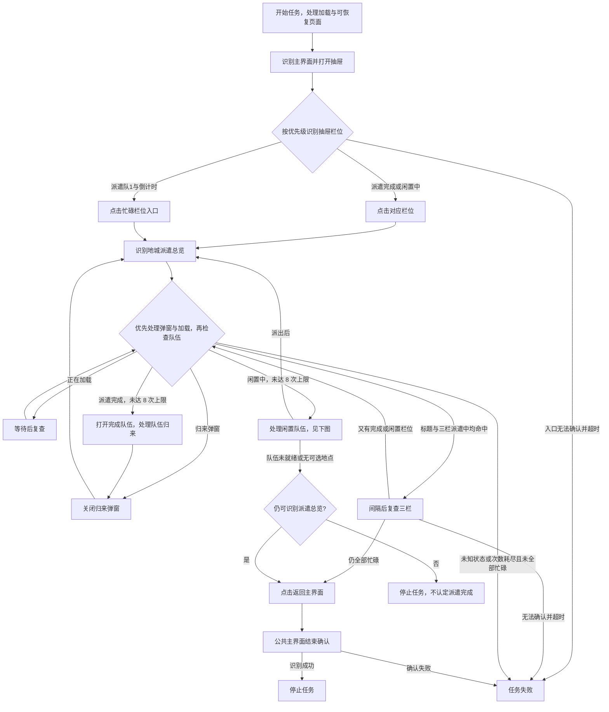
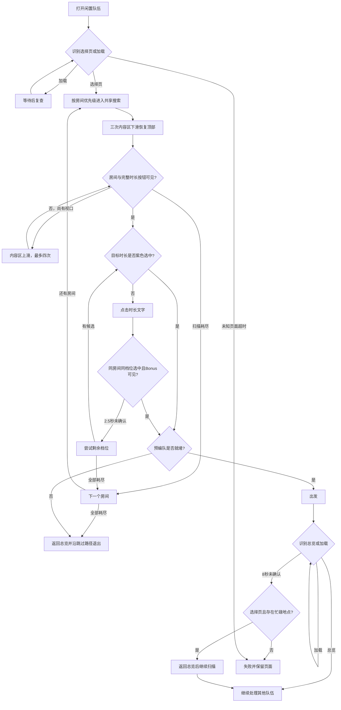

# 每日派遣（DailyDispatch）

收回已完成的派遣，并按用户优先级使用预编队处理闲置队伍；不自动编队或补充角色。

## 使用前提

- 游戏位于主界面，地城派遣功能已解锁。
- 确认“派遣地点优先级”和“派遣时间优先级”。
- 所有需要助手处理的派遣栏位均已在游戏内编好可出发队伍；助手不会自动编队或补充角色。

## 选项与资源消耗

| 选项           | 默认值                           | 行为与限制                                                    |
| -------------- | -------------------------------- | ------------------------------------------------------------- |
| 派遣地点优先级 | 寝室-地牢-训练所-宝藏库-封印密室 | 按顺序尝试可选地点；不是保证一定选择首项                      |
| 派遣时间优先级 | 最大时间优先                     | 按房间识别 22/12/9/6 小时；验证选中态后出发，全部不可用则跳过 |

默认值及候选配置来源为 `assets/interface.json` 的同名选项。派出会使预编队进入游戏内派遣状态；本流程不包含购买或付费加速分支。

## 页面流程

1. 打开左侧抽屉，根据栏位状态进入地城派遣总览。
2. 优先打开“派遣完成”栏位，收回队伍并关闭归来弹窗。
3. 打开“闲置中”栏位，按配置顺序选择地点，并按时长文字直接选择派遣时长。
4. 检查预先编好的队伍是否满足出发条件；满足后派出，继续扫描其他栏位。
5. 总览标题与三个栏位的“地城派遣中”同时命中后，间隔复查一次，仍全部忙碌才返回主界面。
6. 队伍未就绪时不进行编队，沿明确跳过分支返回主界面；此分支不代表三队均已派出。

“全部忙碌”通过 `__DailyDispatchSlot1Busy` 至 `__DailyDispatchSlot3Busy` 的独立窄 ROI
逐栏确认，`DailyDispatchVerifyComplete` 与返回节点分别检查一次。完成和闲置候选优先，
复查期间新出现的目标仍交回原处理链。出发后返回总览继续扫描，不是派出一个队伍就结束。
公共结束确认见 [公共主界面恢复](common_navigation.md)。

闲置队伍的选点、选时与出发子流程如下。

地点优先级按房间名称生效，不使用可见时长结果的序号代替房间身份。每个房间先执行三次有页面识别的内容区下滑恢复顶部，再扫描最多五个视口（最多四次 200 像素短上滑，保留视口重叠）；滑后仅等待列表区域稳定；仍未找到可用档位才尝试下一个房间。搜索步骤可被后续队伍复用，不依赖全任务累计的命中次数作为单队额度。

房间内默认按 22 → 12 → 9 → 6 小时尝试；「短时间优先」反转顺序。自定义识别器先 OCR 房间名称，再仅在该房间下方区域寻找完整可见的时长文字。匹配结果必须唯一；房间名称被忙碌遮罩覆盖或按钮不完整时，不点击。

目标时长已呈紫色选中态时不重复点击，因为重复点击会取消选择。未选中才点击实际 OCR 框，随后同时确认同一房间、同一时长的紫色选中态及 Bonus 区域，再检查预编队。选中验证的 2.5 秒超时与回退属于 Pick 节点；失败继续当前房间剩余时长，全部不可用后尝试下一房间。

进入闲置队伍时会重新核对选项，不直接沿用游戏保存的历史房间、时长或滚动位置。所有房间耗尽后返回总览并沿明确跳过路径退出，不反复打开同一闲置栏位，也不宣称三队均已派出。

## 页面识别

| 页面状态 | 识别目标                          | 识别方式           | ROI/素材         |
| -------- | --------------------------------- | ------------------ | ---------------- |
| 抽屉栏位 | 派遣完成、闲置中、派遣队1与倒计时 | OCR/And            | 左侧抽屉栏位区   |
| 派遣总览 | 地城派遣                          | OCR                | 页面标题区       |
| 归来弹窗 | 队伍归来/隊伍歸來                 | OCR                | 弹窗内容区       |
| 派遣时长 | 6/9/12/22hrs 及繁体变体           | OCR + 直接点击文字 | 列表内容区       |
| 队伍就绪 | 出发按钮和队伍槽蓝绿色            | And + ColorMatch   | 队伍与底部按钮区 |

## 关键判断与异常处理

- 打开抽屉、从倒计时或可操作栏位进入总览、返回主界面均由下一页面识别承接。
  这些路径不等待整屏静止，避开总览持续动画；保留点击前稳定等待。
- 点击“出发”后优先等待游戏自动返回总览，不根据过渡期间其他地点的“正在派遣中”立即点击返回。
  8 秒内未进入总览时，只有选择页的“Bonus 奖励条件”和忙碌地点文本同时命中才执行返回；
  返回后重新判断总览或经公共节点确认主界面。出发与该回退均不等待整屏冻结。

- 队伍未满足出发条件时不自动编队或补充角色，返回派遣总览后退出到主界面并结束任务。
- 锁定档位仍显示时长文字时可能被尝试一次；只有同一档位选中态验证成功才继续。未知弹窗导致选择页无法识别时停止，不能假定所有锁定表现均可恢复。
- 全部房间不可选时走明确跳过路径。未知页面、返回无法确认或识别异常仍可能失败，并保留当前页面。
- 完成与闲置候选未命中后，必须连续两次确认总览标题及三栏派遣中才执行正常返回。
  抽屉入口无法确认时不再仅凭主界面仍可识别就结束。
- “派遣完成”和“闲置中”入口节点分别最多命中 8 次，这是各入口节点的总上限，不表示每个栏位独立重试 8 次。
  达到上限后只有三栏忙碌仍可通过完成检查；仍有目标或总览 6 秒内无法确认已知分支时失败，
  保留当前页面。`DailyDispatchReturnMainAfterOverviewTimeout` 仅保留给队伍未就绪的明确跳过路径，
  不再作为普通扫描超时的成功出口。
- 时间优先级通过 `pipeline_override` 调整共享扫描候选及 `Pick*.on_error`；地点优先级调整入口与房间的 `DispatchNextRoom` 锚点。Override 只覆盖必要字段，目标节点均预先定义。`DispatchSetRoom` 仅更新识别上下文，不执行点击或页面流程。

## 结束条件

- 正常目标：收回完成队伍，并使用预编队处理可出发的闲置队伍。
- 功能完成：总览标题与三栏派遣中均经两次检查，再返回并确认主界面。
- 正常跳过：队伍未就绪或所有房间均未找到可用档位时，按明确跳过分支返回并确认主界面，保留闲置队伍；不代表全部派遣完成。
- 异常终止：上限耗尽且仍有目标、状态不明、入口或返回无法确认时失败或停止，不保证回到主界面，不因只识别到总览标题而报完成。

## 实现索引

| 用途                   | 实现位置                                                                                |
| ---------------------- | --------------------------------------------------------------------------------------- |
| 任务入口与页面流程     | `assets/resource/pipeline/daily_dispatch.json`，入口 `DailyDispatchStart`               |
| 地点与时间选项         | `assets/interface.json` 的任务注册及同名选项 Override                                   |
| 房间与时长关联、选中态 | `agent/dispatch.py`，由 `agent/main.py` 注册                                            |
| 三栏完成确认           | `__DailyDispatchSlot1Busy` 至 `__DailyDispatchSlot3Busy`、`DailyDispatchVerifyComplete` |
| 公共结束确认           | [公共主界面恢复](common_navigation.md)                                                  |

## 已知限制

- 需要在游戏内预先编好队伍，不处理角色补充和自动编队。
- 当前完成判断覆盖三个栏位；其他布局需重新核对识别与结束条件。
- 识别以 720×1280、当前房间卡片布局与紫色选中态为基准；列表最多五个房间。布局、文字或选中配色变化需要重新采集验证。
- 预编队判断仍沿用出发文字与队伍区域颜色，不能替代对所有角色配置的语义检查。
- 真正锁定档位出现未知提示时不保证自动恢复；本文描述实现，不代表这些分支均已完成实机验证。
