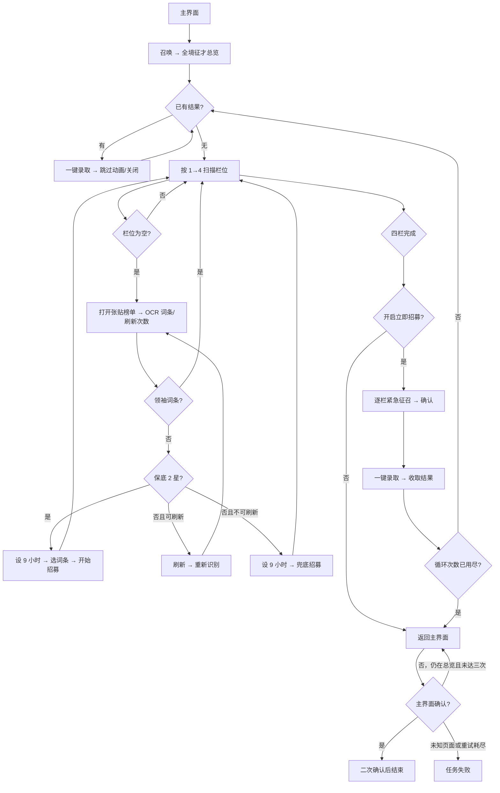

# 全境征才（DailyRecruitment）

处理四个征才栏位，按词条决策招募，并按配置收取结果或执行有限轮立即招募。

## 使用前提

- 游戏位于主界面，全境征才功能已解锁。
- 确认“全境征才立即招募”开关；启用后会消耗立即招募资源。
- 四个栏位可以为空、招募中或已有结果。

## 选项与资源消耗

| 选项             | 默认值        | 行为与限制                                 |
| ---------------- | ------------- | ------------------------------------------ |
| 全境征才立即招募 | 关闭          | 开启后消耗立即招募资源，四栏处理后统一收取 |
| 全境征才循环次数 | 1，范围 1–100 | 仅开启立即招募时显示，控制循环轮数         |

选项及显示关系来自 `assets/interface.json`。普通招募、刷新及立即招募均按游戏规则消耗对应资源；本任务不自动补购不足资源。

## 页面流程

1. 从主界面进入召唤页和全境征才总览，优先领取已有结果。
2. 总览 Router 每轮重新识别四个栏位；发现空栏位时打开张贴榜单页面，并 OCR 读取词条与刷新次数。
3. Agent 计算最优组合：领袖词条跳过；保底 2 星时设置 9 小时并选择词条；无保底且可刷新时刷新；否则兜底招募。
4. 开启立即招募时，四栏处理完后逐个执行立即招募/紧急征召，再统一执行一键录取；收取完成后留在总览并开始下一轮，直到达到“全境征才循环次数”。
5. 未开启立即招募时，四栏处理完成后返回主界面。返回后持续识别主界面，不等待整屏动画静止；仍在征才总览时有限重试，确认主界面后才结束。

## 页面识别

| 页面状态   | 识别目标                     | 识别方式      | ROI/素材                          |
| ---------- | ---------------------------- | ------------- | --------------------------------- |
| 主界面入口 | 召唤按钮                     | TemplateMatch | `DailyRecruitment/SummonText.png` |
| 征才总览   | 全境征才、张贴榜单、一键录取 | OCR/And       | 标题、四栏及底部按钮区            |
| 词条决策   | 已知词条与刷新次数           | Agent 内 OCR  | `TAG_ROI`、`REFRESH_ROI`          |
| 招募设置   | 招募时间、开始招募           | OCR           | 设置页和底部按钮                  |
| 立即处理   | 立即招募/紧急征召            | OCR/And       | 总览栏位区                        |

## 关键判断与异常处理

- 已在招募中的栏位不会进入设置页；`DailyRecruitOverviewComplete` 必须先确认总览标题，再逐栏确认“停止招募 / 紧急征召 / 立即招募”或本轮明确跳过的领袖词条。仅标题命中或空栏位 OCR 暂时漏识别均不能认定四栏完成，会继续尝试；无法确认则超时失败。刷新最多执行有限次数，之后强制走兜底招募。
- 每个空栏位在单次任务中最多打开一次；出现领袖词条并取消设置后，该栏位保持为空，但总览 Router 会跳过已处理栏位并继续扫描后续栏位，避免重复打开形成死循环。
- 无有效词条或 OCR 失败时不选择词条，但仍设置 9 小时并尝试开始招募。
- 词条优先按五个按钮的窄 ROI 逐项识别；宽 ROI 仅作漏识别补充，并使用 OCR 检测框定位实际按钮。
- 启用立即招募时先处理所有立即按钮，再一键录取，避免每栏重复结算。
- 进入全境征才后直接识别目标页面，不等待整屏动画静止；循环入口以完整“全境征才”标题触发初始化，
  不依赖收取已有结果后才进入循环计数。
- “全境征才循环次数”仅在启用立即招募时显示；每轮回到总览前会清理栏位、领袖跳过和立即招募节点的命中计数，避免上一轮状态阻止下一轮扫描或把旧的跳过状态当成本轮完成依据。
- 一键录取后的角色展示会持续播放动画，收获链不等待整屏冻结，而是持续识别 `SKIP` 和结果汇总页的“关闭”；只有“关闭”超时未识别时才点击底部兜底坐标。
- 栏位处理完成后统一返回总览 Router；兜底点击“开始招募”前必须先识别设置页的“招募时间”，若状态与已知页面均不匹配则停止。

## 结束条件

- 功能完成：四栏状态均已确认，已有结果按配置收取；启用立即招募时按循环设置处理，最后返回并确认主界面。
- 正常跳过：已在招募中的栏位保留；领袖词条明确跳过，可能仍为空栏，不代表已替用户开始招募。
- 异常终止：不能确认四栏状态、设置页不明或返回失败时，不认定完成；识别不确定时不得消耗立即招募资源。

`DailyRecruitmentReturnFromOverview` 经 `DailyRecruitmentDone` 进入公共二次确认；超时且仍在总览时最多点击三次，未知页面或重试耗尽则失败。

## 实现索引

入口节点：`DailyRecruitmentStart`；实现文件：`assets/resource/pipeline/daily_recruitment.json`、`agent/recruitment.py`。

页面识别见上表；公共返回与结束确认见[公共主界面恢复](common_navigation.md)。

## 已知限制

OCR 失败或没有有效词条时仍可能按九小时兜底招募，不能将任务完成理解为全部栏位都采用了最优词条。
