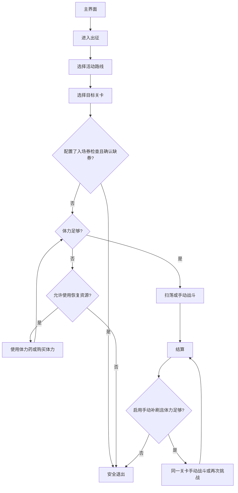

# 消耗体力（DailyStamina）

按所选关卡配置寻找目标，优先扫荡，并按开关决定手动补刷与首次消费前的体力补充。自动推进 NEW 关卡属于暂未开放的[自动战斗](auto_battle.md)，不是本任务的可选模式。

## 使用前提

- 游戏位于主界面，目标活动和关卡已解锁。
- 先在“活动”选择预设或本地添加的活动，再从“关卡”选择本次运行的目标。预设路线、关卡文本和体力消耗由 `assets/stamina/active.yaml` 维护。
- 确认“扫荡不足时手动补刷”“使用体力药”和“购买体力”开关。后两项会消耗资源，默认关闭。
- 这三个选项更新为明确的“关闭 / 开启”后，旧配置会回到“关闭”。需要继续使用的选项请重新开启。
- 活动栏位本体分为常规活动、复刻活动和大型活动；活动开放数天后出现的挑战活动是附加入口，当前不纳入适配范围。
- 进入活动本体后，内部 UI 必须先分为四类：常规活动 UI、复刻活动 UI、大型活动特殊 UI、日常政务 UI。
  常规活动 UI 还要继续区分普通纵向关卡列表和常规活动分页关卡列表，两者的目标扫描与翻页方式不同。
- 复刻活动使用二维地图路线；大型活动按真实内部 UI 分为“关卡图标页”和“直接关卡页”两条入口。两条大型活动路线动作与进入后的页面不同，不合并为同一状态链。

活动更新时在 `assets/stamina/active.yaml` 的 `activity_groups` 中维护活动级名称与 marker，并在 `cases` 中填写各关卡差异；跨活动复用的 UI 路线保留在 `templates`。随后运行 `python tools/build_stamina_activities.py` 生成 `assets/interface.json` 中的活动 Case，不要直接编辑生成字段。提交前使用 `python tools/build_stamina_activities.py --check` 确认源配置与派生产物同步；脚本通过只代表配置一致，新增或变化的活动路线仍须在模拟器中验证。

升级到两级选项后，旧的合并选项会重置，请重新选择目标。增删或重排预设活动会重置预设活动选择。仅调整一个预设活动的关卡列表时，只重置该活动的预设关卡选择。每级默认选中首项，识别参数变化不重置选项。

## 选项与资源消耗

在支持活动编辑的桌面完整包中，点击体力任务最下方的“添加活动”。在弹窗填写活动信息，再用“添加关卡”逐行填写完整关卡名称和每次体力消耗。保存后活动立即出现在上方下拉框中，选中活动即可切换它的各个关卡。每次运行使用一个所选关卡。

- 活动类型可选“普通列表活动”“常规分页活动”或“复刻地图活动”，对应不同的寻路模板。
- 活动分区可选“限时活动”或“目前活动”。活动名称填写活动卡的完整标题，简繁体需与游戏显示一致。协会共斗和挑战活动会在输入校验时被拒绝。
- 列表或地图标题用于确认已进入目标活动。留空时使用活动名称，活动内标题不同时可单独填写。
- 常规分页活动通过左箭头回到第一页，在每页上下寻找目标，未找到时识别右箭头并继续下一页。复刻地图活动可选中路、左路或右路作为后续搜索区域。
- 每次体力消耗默认 30，必须按目标关卡实际消耗填写正整数。自定义模式的预留体力为 0。
- 名称中的正则特殊字符按普通文字匹配。活动卡标题和关卡按完整名称识别，复刻地图允许识别结果附带体力标记。必填名称为空或体力消耗无效时，入口校验失败，错误写入 Agent 日志。

选中本地活动后可用“编辑此活动”修改信息以及新增或移除关卡。删除正在使用的关卡后需要重新选择目标，任务启动时会拒绝已失效的选择。活动库保存在客户端的 `config/stamina-activities.json`，同一安装下的实例共享活动库，各任务分别保存所选活动和关卡。资源更新后，本地活动与关卡选择按保存的标识恢复。旧客户端可继续通过“自定义关卡”填写单个关卡，原有手填配置仍可在该入口使用。

| 选项                 | 默认值或来源            | 消耗与限制                                       |
| -------------------- | ----------------------- | ------------------------------------------------ |
| 活动、关卡           | YAML 中首个活动及其首关 | 消耗关卡所需体力及扫荡资源                       |
| 扫荡不足时手动补刷   | 关闭                    | 开启后可能继续同一关卡战斗                       |
| 体力不足时使用体力药 | 关闭                    | 首次消费前每次一瓶，复核体力后才可继续，最多十瓶 |
| 体力不足时购买体力   | 关闭                    | 首次消费前最多购买一次；当前不限制价格           |

成功扫荡或战斗后不再补充体力。运行前确认目标和消耗；手动补刷不自动开启 AUTO。

- “活动”和“关卡”共同配置目标路线、识别文本及体力阈值。当前选项用于指定关卡扫荡。
- “扫荡不足时手动补刷”控制 `DailyStaminaManualStart`，默认关闭。扫荡后仍有足够体力，或者扫荡设置明确显示扫荡券为 0 并已关闭弹窗时，才从关卡详情进入补刷。需要入场券的关卡还须满足对应门槛。
- “体力不足时使用体力药”和“体力不足时购买体力”控制首次消费前的回复分支，默认关闭。
- 手动补刷识别到战斗进行标识后，由 `DailyStaminaWaitBattleResult` 在有限时间内轮询结算。读到完整且足够的体力值并识别到“再次挑战”时才尝试继续同一关卡。点击后须重新识别战斗开始；若无法确认进入下一战，则从已识别的结算页返回地图。运行前需自行确认游戏内 AUTO 设置。

## 页面流程

1. 从主界面进入出征，由 `DailyStaminaPresetRouteStart` 选择限时活动或日常政务等统一外部路线。
2. 点击活动页签后先识别底部“进击”或“选择关卡”，确认已到活动卡页；未切换成功时最多重新点击页签三次，禁止在其他页面盲点活动卡坐标。活动卡页默认已经选中第一栏，先检查当前活动名；不匹配时按顺序尝试第二栏和第三栏，识别出第二栏是协会共斗或挑战活动时直接检查第三栏。每次切换后须同时确认活动名和活动卡页的进入按钮。进入后先确认对应活动的列表或地图标记，再走对应内部路线。未进入时最多重试 4 次，仍失败则返回主界面。
3. 进入目标关卡详情后，先处理已配置入场券检查的关卡。入场券耗尽时返回主界面。随后由 `DailyStaminaCompare` 读取体力，并与关卡消耗及保留值比较。首次扫荡或开战前的低体力分支可以按开关使用体力药或购买体力。
4. 体力足够时优先打开军团扫荡。开始前识别正整数扫荡次数；明确缺扫荡券时先关闭设置，再根据开关和详情页是否可以开战决定是否补刷。购买后关闭刷新弹窗，再判断当前体力，单轮最多确认一次购买。
5. 扫荡动画的“跳过”和结果页的“完成”分别识别与点击；成功扫荡或战斗后进入已消费状态。扫荡后由 `DailyStaminaAfterSweepDecision` 判断是否手动补刷；战斗结算时体力足够则点击“再次挑战”，不足则返回地图并退出，不再补充体力。

## 内部 UI 分类与关卡列表适配

进入活动本体后，先识别内部 UI 类型，再选择关卡搜索路线：

| UI 类型         | 关卡列表形态           | 当前路线                                                                          |
| --------------- | ---------------------- | --------------------------------------------------------------------------------- |
| 常规活动 UI     | 普通纵向列表           | `DailyStaminaRouteInnerNormalListStart`                                           |
| 常规活动 UI     | 分页列表               | `DailyStaminaRouteRegularPagedFirstPageStart`                                     |
| 复刻活动 UI     | 横向/纵向二维地图      | `DailyStaminaRouteInnerRerunUiStart`                                              |
| 大型活动特殊 UI | 活动专用关卡页或图标页 | `DailyStaminaRouteInnerSpecialUiStart` / `DailyStaminaRouteInnerChallengeUiStart` |
| 日常政务 UI     | 分类后的常规关卡列表   | `DailyStaminaRouteDailyAffairsStart`                                              |

普通纵向列表在当前页有限次上下滑动。分页列表先确认活动列表与左箭头，向前翻到首页；随后逐页扫描初始视口和上下滑动后的视口。每页最多上下各滑动两次，每个方向最多翻页八次，找到目标立即进入详情，没有目标或到达边界则安全返回。

复刻地图使用 `rerun_activity_map` 路线，由活动配置提供页面 marker、目标侧及关卡识别文本。先检查可见目标，未找到时按目标侧横向移动，再有限上下扫描。横移与上下扫描后，等待地图关卡区连续稳定 500 毫秒，再重新截图识别目标，避免点击滑动中的旧位置。

点击目标后由 `DailyStaminaRerunStageDetailReady` 确认详情页“军团扫荡”，才进入体力决策；仍在地图时重新识别目标并有限重试，失败后安全返回。只处理已解锁且满足扫荡条件的指定目标，不推进中间的剧情关卡。

## 页面识别

| 页面状态       | 识别目标                                            | 识别方式                    | ROI/素材                       |
| -------------- | --------------------------------------------------- | --------------------------- | ------------------------------ |
| 活动区与活动卡 | 限时活动/目前活动及活动名称                         | OCR                         | 由 YAML 模板生成 Override      |
| 关卡列表       | 目标关卡、活动标题、左右翻页箭头                    | OCR、TemplateMatch          | 由活动配置及分页节点提供 ROI   |
| 关卡详情       | 军团扫荡、开始、体力及适用关卡的入场券              | OCR + `DailyStaminaCompare` | 体力 ROI 默认 `[500,0,180,45]` |
| 战斗与结算     | `WAVE`/`TURN`、`CLEAR`/获得道具、再次挑战、返回地图 | OCR + `DailyStaminaCompare` | `DailyStaminaWaitBattleResult` |
| 体力回复弹窗   | 回复方式、消耗数量、剩余次数、确认/取消             | OCR                         | 弹窗中央与底部按钮区           |

## 关键判断与异常处理

- 战争演习预设在详情页识别入场券。明确为 0 时优先退出；自动回复体力和从详情开战需读到有券。若游戏在扫荡或开战时弹出“入场券不足”，识别到该提示与对应“确定”才关闭并返回。
- 首次消费前的体力不足弹窗由游戏选择默认回复页。程序先处理当前页中已启用且可识别的回复方式，再按需切换标签。启用用药时每次只确认 1 瓶，首次消费前最多确认 10 次；购买最多确认一次。扫荡与战斗路径不再发起回复消费。
- 普通列表有限次上下扫描仍找不到关卡时安全返回，不无限滑动。
- 活动栏位中找不到指定活动时，从已识别的活动卡页返回并确认主界面。
- 指定关卡只有在体力 OCR 明确满足“关卡消耗 + 预留值”且识别到“军团扫荡”按钮时才会打开扫荡；体力解析失败时返回主界面，不按“足够”处理。
- 魔晶石回复页会显示本次价格、回复量和今日剩余次数；现有购买节点仅确认弹窗类型，不限制价格。
- 魔晶石不足且游戏提示使用魂晶购买魔晶石时，Pipeline 会点击该提示的“取消”，回到魔晶石回复页，再复用未购买时的关闭弹窗与返回主界面流程；不会消耗魂晶。
- 确认购买后弹窗不会自动关闭，而是立即刷新成下一次购买确认；Pipeline 会点击“取消”关闭弹窗，并由 `DailyStaminaCurrencyPurchasedState` 记录本次任务已经购买。后续仍有足够体力时继续扫荡/战斗，再次体力不足时直接退出，不再点击入口并打开第二个购买弹窗。
- 道具回复页无药时，按购买开关决定切换回复方式或关闭弹窗。有药时只确认单瓶，随后关闭刷新弹窗，在关卡详情重新读取完整体力数值。只有读到体力比用药前增加，才重新判断能否扫荡或继续用药。余额未增加、无法读取或页面异常时退出或安全停止。
- `DailyStaminaStartSweep` 点击后不等待全屏静止，立即分别监听上下两个实机位置的“跳过”；动画结束后由独立的“完成”节点点击固定中心。只有点击过“跳过”或“完成”后，结果分发器才允许把关卡详情识别为扫荡完成，避免动作尚未生效时提前回到详情决策。
- `DailyStaminaStartSweep` 在 180 秒内未识别到已知后续页面时进入
  `DailyStaminaRecoverSweepTimeout`。恢复分发器只处理已有 Loading、体力回复、扫荡结算、关卡详情、
  关卡列表和主界面；均不匹配时由 `DailyStaminaStopAfterSweepTimeout` 直接停止，不点击未知弹窗。

## 结束条件

- 功能完成：目标关卡扫荡或手动补刷结束，按已知页面返回并确认主界面。
- 正常跳过或提前退出：体力不足且无法按配置补充、目标不可用或有限扫描未找到目标时，尝试已知页面返回；不表示已消耗体力。
- 异常终止：识别失败或扫荡超时后无法确认已知页面时，不认定完成；`DailyStaminaStopAfterSweepTimeout` 原地停止，不能保证返回主界面。可识别的体力回复弹窗优先取消。

## 实现索引

- 入口 `DailyStaminaStart` 及主流程：`assets/resource/pipeline/daily_stamina.json`。
- 活动路线与预设：同目录 `daily_stamina_routes.json`、`daily_stamina_presets.json`。
- 随资源分发的活动与自定义路线模板：`assets/stamina/active.yaml`；由 `tools/build_stamina_activities.py` 生成 Interface Case。
- 本地活动弹窗和选项加载位于 [MFAAvalonia 前端补丁](../../../tools/frontend_candidate/README.md)。
- 自定义输入校验与运行时识别配置为 `agent/stamina.py` 的 `DailyStaminaConfigureCustom`；体力比较为同文件的 `DailyStaminaCompare`。公共返回见[公共主界面恢复](common_navigation.md)。

## 已知限制

自定义支持普通列表、常规分页列表和复刻地图，沿用现有三个活动栏位。日常政务分类、图标入口和大型活动专用路线由预设适配。复刻地图目标需要已解锁，挑战活动入口不参与搜索。购买体力按弹窗当前价格执行，手动补刷前须自行确认战斗设置。
