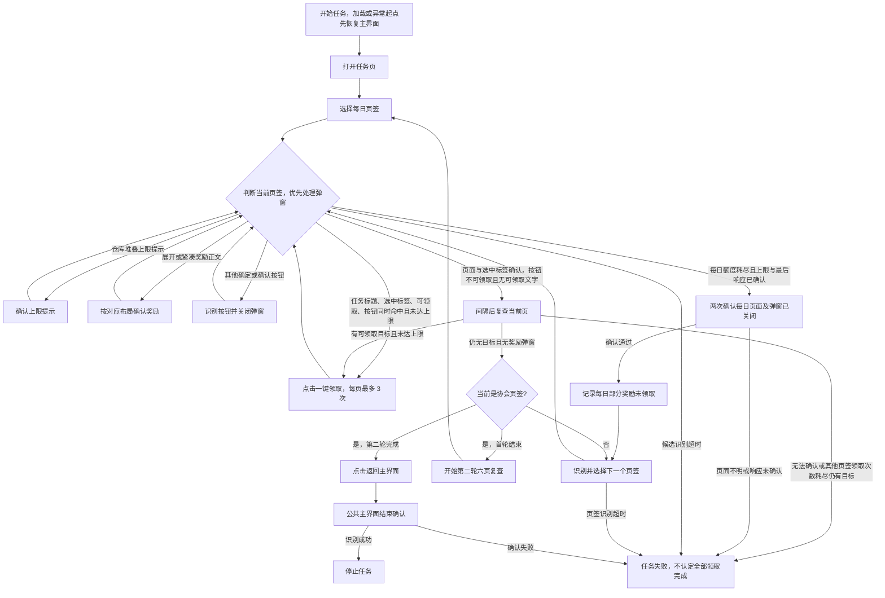

# 奖励领取（DailyTaskRewards）

入口节点：`DailyTaskRewardsStart`；实现文件：`assets/resource/pipeline/daily_task_rewards.json`、`agent/completion.py`、`agent/task_rewards.py`。

## 前置状态

- 游戏位于主界面，任务页面已解锁。
- 每日、每周、每月、个人、活动和协会页签可能没有可领取奖励。

## 主流程

1. 从主界面打开任务页面并选择每日页签。
2. 同时确认任务页标题、可领取文本和一键领取按钮；命中后点击并关闭奖励或仓库堆叠上限弹窗。
3. 依次处理每周、每月、个人、活动和协会页签。
4. 每页均确认选中标签、任务标题和领取按钮，并连续两次确认按钮不可领取且列表无可领取文本后才切页。
   每日页若本次任务已明确遇到堆叠上限、三次领取额度已耗尽且最后一次响应已确认，允许在两次核对每日页面、无奖励弹窗后跳过剩余奖励。
5. 六页处理后重新从每日开始复查一轮，共用每页三次领取上限，第二轮通过后返回主界面。

页签顺序固定为 **每日 → 每周 → 每月 → 个人 → 活动 → 协会**。领取或关闭弹窗后重查当前页签，
每页通过两次完成检查才进入下一页；第二轮复用相同领取节点，不重置领取次数。
每日仅在下述堆叠上限例外下允许记录部分未领取后切页；其余上限耗尽仍有目标的情况失败。
页签点击未生效时有限重选，累计最多四次。
公共结束确认见 [公共主界面恢复](common_navigation.md)。

## 页面识别

| 页面状态     | 识别目标                                 | 识别方式 | ROI/素材                                                |
| ------------ | ---------------------------------------- | -------- | ------------------------------------------------------- |
| 任务页面     | 任务                                     | OCR      | 页面标题区                                              |
| 页签         | 每日、每周、每月、个人、活动、协会       | OCR      | 两行页签区域                                            |
| 可领取状态   | 可领取                                   | OCR      | 任务列表区域                                            |
| 领取按钮     | 一键领取                                 | OCR      | 页面底部按钮区                                          |
| 普通奖励弹窗 | 奖励已增加至仓库                         | OCR      | 按正文纵坐标区分紧凑和展开布局                          |
| 仓库上限弹窗 | 可领取的物品已超过堆叠上限，请至仓库确认 | OCR      | 页面中部提示区                                          |
| 弹窗按钮兜底 | 确定、确认                               | OCR      | 页面中部至下部按钮区，`DailyTaskRewardsCloseClaimPopup` |

## 异常与分支

- 返回主界面不再等待全屏静止，交给公共结束确认；入口通过公共恢复关闭礼包，避免被登录遗留页面阻挡。
- 某页签无可领取任务时，通过当前页完成检查后进入下一页签，不点击固定位置。
- 领取动作使用 And 组合页面标题、可领取文本和按钮，并通过 `box_index: 2` 点击按钮识别框。
- 每个页签限制最大领取次数。普通奖励弹窗按“奖励已增加至仓库”的纵坐标区分紧凑和展开布局，仓库上限弹窗
  识别完整提示正文；两者均点击各自稳定的确认区域，再返回当前页签继续判断。
- `DailyTaskRewardsCloseClaimPopup` 继续以“确定/确认”OCR 作为兜底，避免未知弹窗布局阻挡后续页签点击。
- `TaskCompletionGuard` 在同一截图中核对标题、选中标签颜色、领取按钮文字及不可领取颜色，
  同时排除可领取文本与奖励/仓库上限正文。未执行成功或被禁用的必要检查一律拒绝完成。
  正文、标签或按钮样式变化时应重新采集，不能只保留“未识别到可领取”的负面依据。

### 每日堆叠上限例外

- 每日的分发节点使用独立的 `DailyTaskRewardsCloseDailyInventoryFullPopup` 关闭上限提示，最多关闭六次，容纳有限重试；其他页签沿用公共上限处理，不触发每日跳过。
- 关闭提示后继续尝试领取，正常奖励弹窗仍按原流程关闭。每日两轮累计最多三次领取，不因出现上限提示追加额度。
- `DailyTaskRewardsInventorySkip` 只读取当前 TaskDetail 的已完成节点：每日领取次数必须达到额度，至少一次上限提示须发生在每日领取后，最后一次每日领取还须有已关闭的上限或普通奖励弹窗作为响应依据。
  只有识别命中、动作未完成的节点不计入次数或上限证据；每日出现未知弹窗并走通用兜底时，先前的响应确认作废，不能据旧上限证据继续跳过。状态不保存到全局变量，不在任务间继承。
- `DailyTaskRewardsVerifyDailyInventorySkip` 与 `DailyTaskRewardsSkipDailyInventoryFull` 间隔核对每日选中、任务标题、一键领取按钮及无奖励/上限弹窗；页面不明时仍失败。
- 跳过节点记录 `status: partial` 和“每日部分奖励因堆叠上限未领取，继续检查其他页签”的 focus 消息；focus 的可见展示取决于前端支持，识别详情始终用于区分部分跳过和全部领完。
  第二轮可凭本次任务内的同一份证据跳过每日，不再尝试第四次领取；每周等其余页签继续严格完成检查。

## 完成状态

- 正常目标：检查六个页签并领取当前可领取奖励。
- 成功条件：两轮六页分别通过完成检查，或每日满足堆叠上限例外后跳过，最后返回并确认主界面。
- 每日跳过属于“已处理但部分未领取”，不认定所有奖励到账。每页最多领取三次；没有每日上限证据、最后响应未确认、其他页签仍有目标或页面不明时失败并保留页面。
- 正常完成返回游戏主界面；完成检测不保证不可见任务或未知客户端布局均被识别。
