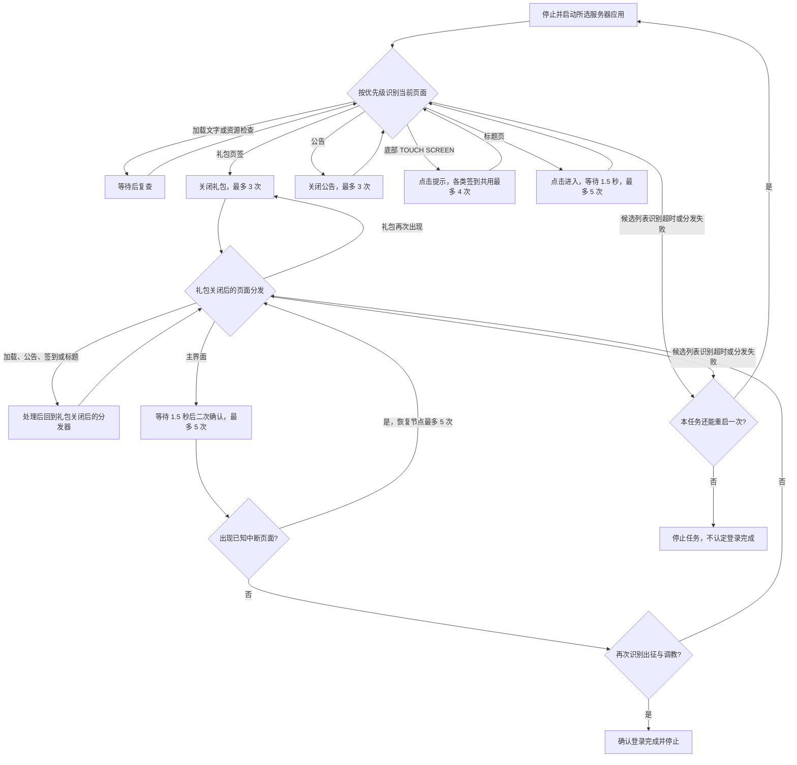

# 启动游戏（GameLogin）

启动所选服务器的游戏，处理已知登录页面，关闭本轮登录礼包后再二次确认主界面。

## 背景说明

两个服务器当前共用登录 Pipeline，通过“选择服务器”切换应用包名。该配置不保证两个渠道今后的页面始终一致；出现差异时需重新观察。

## 使用前提

- 模拟器已安装所选服务器对应的游戏包，并允许从主界面启动应用。
- 在任务选项“选择服务器”中确认包名：工口服务器为 `com.pinkcore.tkfm`，erolab 服务器为 `com.pinkcore.tkfm.erolabs`。

## 选项与资源消耗

| 选项       | 默认值     | 行为与限制                                   |
| ---------- | ---------- | -------------------------------------------- |
| 选择服务器 | 工口服务器 | 切换启停应用的包名；不自动安装游戏或登录账号 |

默认值来自 `assets/interface.json`。工口服务器包名为 `com.pinkcore.tkfm`，erolab 为 `com.pinkcore.tkfm.erolabs`。本任务会停止并重新启动所选应用，不包含购买分支。

## 页面流程

1. 关闭已运行的游戏应用，再启动所选服务器的游戏包。
2. 启动后进入统一状态分发器，按当前画面处理加载、资源检查、公告、标题页、首登弹窗、礼包和主界面。
3. 通过 `TAP TO START` 或版本号确认标题页后点击进入游戏，再返回同一状态分发器识别点击后的新页面；
   点击未生效时由同一节点限频、有限次重试。
4. 出现活动登录奖励或常规签到时，仅识别底部 `TOUCH SCREEN`，点击提示后重新判断页面；
   出现王城公布栏时关闭公告。页面顺序由当前画面决定，不要求每次登录都出现全部页面。
5. 等待本轮必定弹出的登录礼包，识别包含限时、精选、月卡的页签后点击左上角返回按钮。
   关闭礼包前不检查主界面完成条件；即使先看到主界面，也继续等待礼包。
6. 关闭礼包后进入允许主界面确认的状态分发器。首次识别主界面后进入 1.5 秒二次确认窗口；
   期间出现礼包、签到或加载时重新分发，再确认主界面后结束。1.5 秒只用于关闭礼包后的复核，不是等待礼包弹出的期限。

图中分支按当前画面选择，加载、礼包、公告、通用签到、标题依次具有识别优先级；仅关闭过本轮礼包后才加入主界面候选。
分发器的候选列表超时为 360 秒，不是整轮登录的总时限；达到次数上限的节点不再执行。

## 页面识别

| 页面状态   | 识别目标                             | 识别方式  | 动作                                |
| ---------- | ------------------------------------ | --------- | ----------------------------------- |
| 资源检查   | `资源检查中`或`档案读取中`           | OCR       | 等待并返回所属状态分发器            |
| 启动加载   | `LOADING`/`LOAD ING`                 | OCR       | 等待并返回所属状态分发器            |
| 王城公布栏 | `王城公布栏`、`活动公告`或`最新公告` | OCR       | 点击底部关闭区域                    |
| 标题页     | `TAP TO START` 或版本号              | OCR       | 点击底部进入区域                    |
| 活动签到   | 底部 `TOUCH SCREEN` 提示             | And + OCR | 点击识别出的底部提示                |
| 常规签到   | 底部 `TOUCH SCREEN` 提示             | And + OCR | 点击识别出的底部提示                |
| STEP 礼包  | `STEP`、限时、精选或月卡页签         | OCR       | 点击左上角返回区域                  |
| 主界面     | 出征与调教同时存在                   | And + OCR | 二次确认后 `GameMainReady` 停止任务 |

## 关键判断与异常处理

- 各类签到统一由 `GameCloseSignIn` 处理，不再依赖活动名称、正文或签到类型。
  底部 ROI `[140, 1080, 440, 170]` 识别 `TOUCH\s*SCREEN`，稳定 300 毫秒后点击识别框，再返回分发器。
  所有签到共用最多 4 次点击额度，达到上限后不再点击。旧公开节点 `GameCloseEventSignIn` 保留为同识别逻辑的兼容入口，不参与分发。

- 礼包优先于签到，签到须存在底部 `TOUCH SCREEN` 提示，避免主界面的“签到奖励”误命中。
  公告、礼包、通用签到和兼容签到关闭节点均在动作前等待识别区域连续稳定 300 毫秒；标题页背景持续动画，按交互稳定性检查脚本豁免。
  关闭页面后立即重新识别，不等待角色动画停止；二次确认期间出现新页面时重新进入分发器。
- 活动签到、常规签到或公告未出现时不应等待固定顺序，而应继续判断礼包页和主界面。
- `GameLoginDispatch` 是礼包关闭前的状态分发器，使用 `DirectHit + DoNothing`，按当前页面选择处理节点，
  不包含主界面确认候选。`GameCloseGift` 执行动作后转入 `GameLoginAfterGiftDispatch`，之后才允许识别主界面。
  该前置条件通过 Pipeline 路径表达，每次重新启动应用都从礼包关闭前的分发器进入，不沿用上一轮状态。
  `timeout: 360000` 是候选列表识别超时，并非整个登录过程的总耗时上限；MaaMCP 测试另设人工超时。
- 加载、资源检查、首登弹窗、公告和标题点击通过 `[JumpBack]` 返回所属状态分发器。
  礼包关闭节点使用普通跳转，动作后显式进入 `GameLoginAfterGiftDispatch`，先重新识别页面再决定下一步。
- 标题页不使用 `TOUCH SCREEN` 识别，避免签到页被当成标题页。各类签到只识别底部提示并点击该框；
  礼包只点击左上角固定返回区域。
- 标题页点击后不要求再次识别 `TAP TO START`；状态分发器会直接识别加载、资源检查、首登弹窗、公告、
  礼包或主界面。仍停留标题页时才会再次命中标题节点。
- 标题点击最多 5 次，点击后等待 1.5 秒再识别。加载文字完整覆盖底部提示，兼容字母间空格，
  `LOADING` / `CONNECTING` 识别命中时只等待，不因仍能看到版本号而继续点击。
- `GameLoginConfirmMain` 仅在关闭本轮礼包后可达，在主界面首次命中后留出 1.5 秒观察窗口。`GameLoginMainInterrupted` 优先检查
  礼包、签到、公告、加载和标题；任何一项出现都返回 `GameLoginAfterGiftDispatch` 重新分发，否则重新识别主界面后停止。
  两个确认节点各最多命中 5 次，避免异常页面反复打断造成无限重试。
- 两个分发器在 360 秒内始终无法识别各自候选页面时，通过 `GameLoginRestartOnce` 最多一次转回
  `GameLoginStart`，复用服务器选项已经覆盖的停止和启动节点。重启后的状态分发器再次超时则由
  `GameLoginStopAfterTimeout` 明确停止任务，不继续重启，也不点击未知页面。
- 网络错误、服务器维护或资源更新页面目前没有专用恢复节点，出现时应安全停止并补充流程记录。

## 结束条件

- 功能完成：本轮已经识别并关闭登录礼包，通过主界面观察窗口，中断页面未命中，再次确认“出征”和“调教”后停止。
- 正常跳过：未出现的签到、公告等页面直接由状态分发器略过，不代表这些页面都已处理或领取奖励。
- 异常终止：礼包始终未出现或无法识别已知页面时最多重启一次；重试后仍超时则停止，不认定登录完成，也不保证停在主界面。

## 实现索引

入口节点：`GameLoginStart`；实现文件：`assets/resource/pipeline/game_login.json`。

页面识别见上表；公共返回与结束确认见[公共主界面恢复](common_navigation.md)。

## 已知限制

网络错误、服务器维护及资源更新页面没有专用恢复分支；无法用登录成功推断所有首登奖励已领取。
